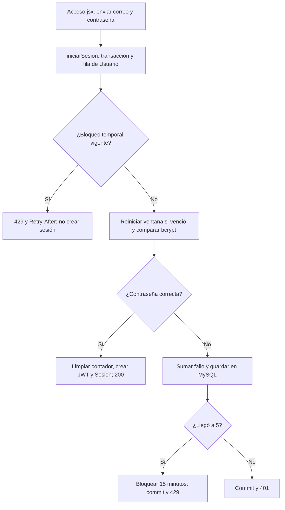

# Gianluca Pizarro · guía de la entrega final

**Responsabilidad:** Cuentas, login y recuperación.

Conservás registro/login/logout y la validación de alimentos del 75 %. En el cierre preparás recuperación por SMTP real, contraseña temporal de un uso, permisos en la sesión y arranque de cuentas.

Este documento asigna estudio, revisión y defensa. No certifica autoría pasada. Antes de exponer, completá las comprobaciones de tu recorrido.

## Primero: base común que puede preguntar el profesor

Leé [BASE-COMUN.md](../docs/BASE-COMUN.md). Son conceptos breves que todos deben entender: carpetas, login, Bcrypt, JWT, middleware, CORS, useState y useEffect. El PDF permite preguntas sobre código de compañeros; no hay garantía de que limite la defensa a este módulo. El detalle profundo que sigue es tu parte.

## Mapa de tu módulo

## Tus endpoints y continuidad

| Etapa | Método y ruta | Handler real |
| --- | --- | --- |
| Base del 50 % | `POST /api/registro` | [registrarUsuario](../backend/controllers/usuarios.controller.js#L70) |
| Base del 50 % | `POST /api/login` | [iniciarSesion](../backend/controllers/usuarios.controller.js#L170) |
| Base del 50 % | `POST /api/logout` | [cerrarSesion](../backend/controllers/usuarios.controller.js#L265) |
| Base del 50 % | `GET /api/salud` | [handler de salud](../backend/index.js#L22) |
| Avance nuevo | `DELETE /api/consumos/:id` | [eliminarConsumo](../backend/controllers/nutricion.controller.js#L502) |

## Funciones concretas del avance

| Función | Qué parte recorrés |
| --- | --- |
| [calcularMacros](../backend/controllers/nutricion.controller.js#L10) | Recorre y suma nutrientes; por 100 g/ml o por porción. |
| [datosComida](../backend/controllers/nutricion.controller.js#L85) | Valida nombre/tipo y obtiene los nutrientes de la comida. |
| [actualizarDieta](../backend/controllers/nutricion.controller.js#L152) | Tu tramo compartido es la validación de metas numéricas y calorías enteras; Iván/Paulo guardan la dieta. |
| [eliminarConsumo](../backend/controllers/nutricion.controller.js#L502) | Borra solo el consumo propio confirmado. |

Los helpers son funciones internas, no endpoints adicionales. Si una función sirve a POST y PUT o a generación y adaptación, se revisa entre los dos responsables. No hay que duplicarla ni separarla artificialmente para aparentar más código.

## Entradas, consultas y respuestas de tus rutas

### `POST /api/registro`

**Qué recibe.** Body JSON: `nombre`, `email`, `password`; `apellido` es opcional.

**Qué ejecuta y consulta.** `Usuario.findOne` busca el correo normalizado. Una transacción crea `Usuario`, busca el `Rol` Cliente, crea `UsuarioRol`, crea `Sesion` y registra `Bitacora`.

**Qué valida o decide.** Nombre de 2–100 caracteres; correo con formato y hasta 150; contraseña de al menos 10 caracteres y como máximo 72 bytes UTF-8. Se calcula bcrypt; no se guarda texto plano.

**Respuesta correcta.** `201` → `{user: datosPublicos(usuario)}` y cookie de sesión. El registro ya deja la cuenta conectada.

**Errores propios.** `400` por datos inválidos; `409` por correo existente; `500` si no se puede registrar.

**Quién lo llama.** Acceso.jsx: `enviar`, modo registro; llama `axios.post("/" + modo, datos)`.

**Cómo mostrarlo.** Registrar una cuenta sintética; repetir el correo para mostrar el rechazo sin crear un duplicado.

### `POST /api/login`

**Qué recibe.** JSON `email` y `password`. El correo se normaliza con trim y minúsculas.

**Qué ejecuta y consulta.** `iniciarSesion` inicia una transacción y busca Usuario activo con `lock: transaction.LOCK.UPDATE`. El bloqueo de fila ordena los intentos simultáneos de la misma cuenta para no perder incrementos. Si falta la cuenta, responde 401. Si `bloqueado_hasta` está en el futuro, devuelve 429 antes de comprobar la contraseña.

**Qué valida o decide.** Si venció el bloqueo o pasaron 15 minutos desde el último fallo, el contador vuelve a cero. `compararPassword` usa bcrypt. Cuando la clave es incorrecta, incrementa `intentos_fallidos`, guarda `ultimo_intento_fallido` y, al llegar a cinco, fija `bloqueado_hasta` a 15 minutos desde ese momento. Confirma la transacción antes de devolver 401 o 429: un rollback aquí perdería el contador. Mientras dura el bloqueo, ni siquiera una contraseña correcta abre una nueva sesión, y el plazo no se prolonga con cada intento.

**Respuesta correcta.** En un acierto permitido, limpia los tres campos, actualiza última conexión, crea JWT y Sesion, registra el evento y confirma. Devuelve 200 con usuario público y cookie HttpOnly; los campos del bloqueo no se exponen en ese JSON.

**Errores propios.** 400 por entrada inválida; 401 por credenciales incorrectas o cuenta no habilitada; 429 al quinto fallo y durante el bloqueo; 500 por error interno. El 429 incluye `Retry-After` y `retry_after_segundos` con el tiempo restante. `Acceso.jsx/enviar` muestra el mensaje que devuelve el backend.

**Cómo mostrarlo.** Con una cuenta ficticia, fallar cuatro veces (401) y una quinta (429); intentar la clave correcta durante el plazo (429). Probar otra cuenta para mostrar que no está bloqueada. No cambiar la hora del equipo para demostrar el vencimiento: las pruebas locales simulan la fecha solo en la fila ficticia.

### `POST /api/logout`

**Qué recibe.** Body JSON: `confirmar: true`; usa la cookie de la sesión actual.

**Qué ejecuta y consulta.** `Sesion.destroy` elimina la fila que coincide con el usuario y el hash de su cookie. Limpia esa cookie del navegador.

**Qué valida o decide.** Requiere sesión válida y confirmación. No elimina la cuenta ni cierra automáticamente todas sus otras sesiones.

**Respuesta correcta.** `204` sin JSON.

**Errores propios.** `400` si no se confirma; `500` si no se puede cerrar. También aplican los errores de sesión comunes.

**Quién lo llama.** App.jsx: `salir`; botón Cerrar sesión y componente Confirmar.

**Cómo mostrarlo.** Cancelar una vez y confirmar después; explicar por qué se vuelve al inicio.

### `GET /api/salud`

**Qué recibe.** No recibe body ni parámetros. Es público.

**Qué ejecuta y consulta.** `sequelize.authenticate()` comprueba la conexión con MySQL; no lista usuarios ni modifica tablas.

**Qué valida o decide.** No es una pantalla de negocio ni comprueba el estado de Cohere.

**Respuesta correcta.** `200` → `{estado: "ok", version: "100"}`.

**Errores propios.** `503` si no puede conectar a la base.

**Quién lo llama.** Comprobación directa del servidor; ninguna pantalla React lo llama.

**Cómo mostrarlo.** Abrir la URL completa del endpoint y explicar qué significa su respuesta.

### `DELETE /api/consumos/:id`

**Qué recibe.** URL `id`; body `confirmar: true`.

**Qué ejecuta y consulta.** Busca `ComidaConsumida` propia y ejecuta `destroy`.

**Qué valida o decide.** Es borrado de un consumo concreto; a diferencia de la dieta no se marca un estado de baja.

**Respuesta correcta.** `204` sin JSON.

**Errores propios.** `400` sin confirmar; `404` consumo ajeno/inexistente; `500` por fallo.

**Quién lo llama.** Nutricion.jsx modo consumos: `eliminar`; Axios manda el body de DELETE en `data`.

**Cómo mostrarlo.** Eliminar solo un consumo sintético y explicar por qué disminuye el total diario.

## Lo que se agrega en el cierre

`recuperarPassword`: valida email y configuración, busca cuenta activa, guarda SHA-256 del token con vencimiento y envía el enlace por SMTP usando Nodemailer. `restablecerPassword`: bloquea la solicitud durante la transacción, verifica vencimiento, cambia bcrypt, elimina sesiones y el token. `cargarRoles` incorpora roles y permisos en la respuesta pública de login; `verificarSesion` verifica JWT y sesión persistida, no solo la firma. El JWT llega en cookie HttpOnly, React no lo lee. En Mailpit se comprueba entrega local, no envío a Gmail. Un envío fallido da 503 y no devuelve un enlace al solicitante.

### Rutas nuevas que defendés

| Método y ruta | Función | Archivo |
| --- | --- | --- |
| `POST /api/recuperar-password` | `recuperarPassword` | [recuperacion.controller.js](../backend/controllers/recuperacion.controller.js) |
| `POST /api/restablecer-password` | `restablecerPassword` | [recuperacion.controller.js](../backend/controllers/recuperacion.controller.js) |

## Preguntas de defensa con respuesta orientativa

**¿Bcrypt cifra o hashea?** Hashea de forma irreversible con salt; se compara con bcrypt.compare. No se descifra una contraseña.

**¿Por qué no guardar el token de recuperación en texto plano?** La base guarda su SHA-256; solo quien recibió el token original puede usar el enlace. Expira y se elimina después del uso.

**¿JWT basta para seguir conectado?** No: además de firma y expiración se busca Sesion y una cuenta activa. Así logout, bloqueo y cambio de contraseña revocan acceso.

## Práctica equivalente para los nueve

- [ ] Recorrer una acción desde el componente hasta MySQL y volver con la respuesta.
- [ ] Mostrar un caso correcto con datos de prueba y persistencia comprobada.
- [ ] Mostrar un caso de datos inválidos y explicar el código HTTP.
- [ ] Mostrar un caso de autorización, cancelación o estado no permitido; no debe cambiar información.
- [ ] Explicar el formulario, las funciones principales, las librerías y el diagrama sin leer código palabra por palabra.
- [ ] Hacer una modificación pequeña y explicar el resultado (por ejemplo un texto, un límite válido o un campo).

## Ensayo individual de 15–20 minutos

2 minutos: ubicar backend/client y tu componente. 5 minutos: seguir una petición propia. 4 minutos: explicar modelo y validaciones. 4 minutos: demostrar éxito/error/cancelación. 3 minutos: responder las preguntas anteriores y los conceptos comunes. No memorizar respuestas sobre funciones que no revisaste.

## Archivos compartidos y continuidad

`backend/index.js` monta las rutas y sirve React; `backend/config/db.js` conecta Sequelize; `backend/models/index.js` relaciona modelos; `client/src/App.jsx` decide navegación y sesión. La base de estos archivos se revisa entre todos. Compartir un archivo no significa que cada persona deba defender todas sus ramas internas: ubicá tu método y seguí sus llamadas.

El reparto final sustituye las estimaciones de carga del corte 75. Cada integrante tiene un paquete completo y la misma lista de comprobaciones; no son porcentajes medidos de autoría ni horas reales.

## Protección por intentos · actualización del 2/11/2026

Esta ampliación corresponde a Gianluca, responsable del login. No se reparte como un endpoint nuevo: cambia el comportamiento de POST /api/login en ambas entregas.

### Campos y archivos para estudiar

- `backend/models/Usuario.model.js`: `intentos_fallidos` entero (0 inicialmente), `ultimo_intento_fallido` y `bloqueado_hasta` fechas opcionales. MySQL conserva esos valores; no son variables globales de Node.
- `backend/controllers/usuarios.controller.js/iniciarSesion`: orden de comprobación, incremento atómico bajo bloqueo de fila, diferencia entre confirmar un fallo y revertir una operación incompleta, apertura de sesión solo cuando corresponde.
- `backend/config/actualizar-login.js/actualizarProteccionLogin`: `describeTable` consulta las columnas; `addColumn` agrega solo las ausentes. El comando se puede repetir sin borrar ni reiniciar cuentas. No se utiliza sync con force ni alter.
- `cambiarPassword` y `recuperacion.controller.js/restablecerPassword`: al confirmar una contraseña nueva, limpian los tres campos y revocan las sesiones anteriores. Una recuperación con token inválido no desbloquea nada.
- `client/src/pages/Acceso.jsx/enviar`: recibe el error de Axios y muestra el mensaje de la API. Ocultar el botón no es la protección: el backend también rechaza peticiones directas.

### Diferencias que tenés que poder explicar

El bloqueo automático protege **nuevos inicios de sesión**, no cambia `estado` a bloqueado ni cierra sesiones que ya estaban abiertas. Así no se confunde con la acción del administrador, que sí cambia el estado y revoca sesiones. El contador es por cuenta/correo normalizado, no por IP ni navegador. Variar mayúsculas o espacios no lo evita.

Un login correcto antes del quinto fallo limpia el contador. Quince minutos sin nuevos fallos reinician la ventana. Una vez alcanzado el umbral, la espera dura 15 minutos y la clave correcta tampoco permite ingresar durante ese plazo. Recuperar la contraseña mediante un enlace válido permite volver a acceder; una cuenta bloqueada manualmente sigue dependiendo del administrador.

**¿Por qué guardar el contador si la contraseña fue incorrecta?** Porque el fallo también modifica un dato: hay que confirmar ese incremento con commit. Si se hiciera rollback antes de responder 401, el bloqueo nunca acumularía intentos.

**¿Qué pasa con dos intentos a la vez?** La transacción bloquea la fila del usuario; el segundo espera y lee el contador actualizado. No hay un contador independiente por petición que sobrescriba el anterior.

**¿Por qué 429 y Retry-After?** 429 indica rechazo temporal por demasiados intentos; Retry-After expresa los segundos de espera. 401 sigue indicando credenciales incorrectas antes de alcanzar el umbral.

**¿Se borra el bloqueo al reiniciar Node?** No: está en MySQL. La aplicación no mantiene la lista de fallos en memoria.

### Práctica de este bloque

Mostrar cinco fallos, rechazo temporal de la clave correcta, otra cuenta independiente y el mensaje visible. Explicar cómo se prueba el vencimiento con datos sintéticos, cómo la recuperación limpia el bloqueo y por qué el bloqueo manual no se levanta automáticamente. Revisar la transacción y localizar los tres campos sin memorizar el código palabra por palabra.
