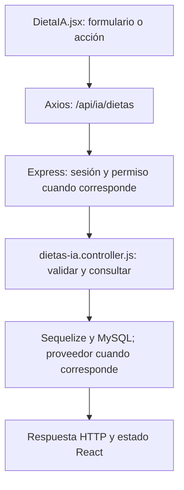

# Tomás Menossi · guía de la entrega final

**Responsabilidad:** Inteligencia artificial y generación de planes.

Conservás chat, historial y generación de rutinas. Sumás generación de dieta nueva y el contrato común de Cohere; Joaquín se encarga del recorrido de adaptación.

Este documento asigna estudio, revisión y defensa. No certifica autoría pasada. Antes de exponer, completá las comprobaciones de tu recorrido.

## Primero: base común que puede preguntar el profesor

Leé [BASE-COMUN.md](../docs/BASE-COMUN.md). Son conceptos breves que todos deben entender: carpetas, login, Bcrypt, JWT, middleware, CORS, useState y useEffect. El PDF permite preguntas sobre código de compañeros; no hay garantía de que limite la defensa a este módulo. El detalle profundo que sigue es tu parte.

## Mapa de tu módulo

## Tus endpoints y continuidad

| Etapa | Método y ruta | Handler real |
| --- | --- | --- |
| Base del 50 % | `GET /api/ia/estado` | [estadoIA](../backend/controllers/ia.controller.js#L452) |
| Base del 50 % | `POST /api/ia/consulta` | [responderConsulta](../backend/controllers/ia.controller.js#L291) |
| Base del 50 % | `GET /api/ia/conversaciones` | [listarConversaciones](../backend/controllers/ia.controller.js#L404) |
| Base del 50 % | `GET /api/ia/conversaciones/:id` | [verConversacion](../backend/controllers/ia.controller.js#L420) |
| Avance nuevo | `POST /api/ia/rutinas` | [generarRutinaIA](../backend/controllers/ia.controller.js#L88) |

## Funciones concretas del avance

| Función | Qué parte recorrés |
| --- | --- |
| [generarRutina](../backend/controllers/ia.controller.js#L52) | Formato y validación de la propuesta; compartida con Joaquín. |
| [generarRutinaIA](../backend/controllers/ia.controller.js#L88) | Genera un plan nuevo sin id; contexto y persistencia compartidos con adaptación. |
| [generarConIA](../backend/controllers/ia.controller.js#L13) | Llamada real a Cohere y validación del JSON. |

Los helpers son funciones internas, no endpoints adicionales. Si una función sirve a POST y PUT o a generación y adaptación, se revisa entre los dos responsables. No hay que duplicarla ni separarla artificialmente para aparentar más código.

## Entradas, consultas y respuestas de tus rutas

### `GET /api/ia/estado`

**Qué recibe.** Sin body.

**Qué ejecuta y consulta.** Lee la presencia de `COHERE_API_KEY` y el modelo en el entorno. No consulta datos de negocio ni llama a Cohere; la autenticación previa sí accedió a la base.

**Qué valida o decide.** Configurada no significa que haya disponibilidad, saldo o calidad garantizada. Nunca devuelve la clave.

**Respuesta correcta.** `200` → `{configurada: boolean, modelo: string}`.

**Errores propios.** No tiene error propio declarado; aplican los de sesión.

**Quién lo llama.** Asistente.jsx: `cargar`.

**Cómo mostrarlo.** Explicar por qué ver Configurada no equivale a haber recibido una respuesta del proveedor.

### `POST /api/ia/consulta`

**Qué recibe.** Body: `consulta` string, `modo` entrenador/soporte; `conversacion_id` opcional para seguir una conversación del mismo modo.

**Qué ejecuta y consulta.** Si hay conversación, busca `Conversacion` propia y últimos diez `Mensaje`. `responderconsulta` llama `generarConIA` (fetch a Cohere). Tras responder, comprueba otra vez consentimiento y en una transacción guarda conversación si es nueva y dos mensajes.

**Qué valida o decide.** Consentimiento obligatorio; consulta no vacía y hasta 2000 caracteres. El chat solo conversa; no ejecuta acciones. Si falla no guarda el par parcial. La clave está en el backend.

**Respuesta correcta.** `200` → `{conversacion_id, respuesta}`.

**Errores propios.** `400` consulta/modo inválidos; `403` sin consentimiento; `404` conversación ajena/inexistente/de otro modo; `503` error del proveedor, respuesta inválida o fallo al guardar.

**Quién lo llama.** Asistente.jsx: `enviar`; agrega los dos mensajes a la pantalla después del éxito.

**Cómo mostrarlo.** Enviar una pregunta de soporte y un seguimiento; ubicar el id de conversación y explicar qué contexto se vuelve a mandar.

### `GET /api/ia/conversaciones`

**Qué recibe.** Sin body; el endpoint no filtra por modo.

**Qué ejecuta y consulta.** `Conversacion.findAll` propia, ordenada por creación descendente.

**Qué valida o decide.** La pantalla filtra por modo. Listar conversaciones no vuelve a consultar al modelo.

**Respuesta correcta.** `200` → `{items: [...]}`.

**Errores propios.** `500` si no puede listar.

**Quién lo llama.** Asistente.jsx: `cargar`, selector Conversación.

**Cómo mostrarlo.** Cambiar modo y explicar por qué el selector muestra un subconjunto de la respuesta.

### `GET /api/ia/conversaciones/:id`

**Qué recibe.** URL: `id` de la conversación. Sin body.

**Qué ejecuta y consulta.** Busca `Conversacion` por id y usuario; después `Mensaje.findAll` por conversación con orden por fecha/id ascendente.

**Qué valida o decide.** Solo lectura de historial. No se llama a Cohere ni se modifican mensajes al abrir.

**Respuesta correcta.** `200` → `{conversacion, mensajes}`.

**Errores propios.** `404` si no es propia/no existe; `500` si no puede consultar.

**Quién lo llama.** Asistente.jsx: `abrir`; cambia conversación, modo y mensajes visibles.

**Cómo mostrarlo.** Abrir una conversación anterior y mostrar que viene de MySQL, sin generar otra respuesta de IA.

### `POST /api/ia/rutinas`

**Qué recibe.** Body: `preferencias` de 3–1000 caracteres y `confirmar: true`. Para adaptar, además `id` en la URL.

**Qué ejecuta y consulta.** Busca última `MedicionFisica`, `Objetivo` activo y últimos cinco `Entrenamiento` completos. Pide a Cohere un JSON de plan, valida ejercicios y vuelve a comprobar cuenta/consentimiento/objetivo. `guardarRutina` persiste cabecera y detalles en una transacción.

**Qué valida o decide.** Debe haber consentimiento, medidas y objetivo activo. No se guardan ejercicios sin validar. Es una propuesta editable, no una prescripción médica. La llamada externa tiene límite de espera y no se reintenta automáticamente.

**Respuesta correcta.** `201` → `{rutina, message}`.

**Errores propios.** `400` por preferencias/confirmación inválidas; `403` sin consentimiento; `409` si faltan medidas u objetivo; `503` si no se obtiene o guarda una propuesta válida.

**Quién lo llama.** Asistente.jsx: `generar` cuando no hay rutina seleccionada.

**Cómo mostrarlo.** Generar con datos sintéticos, abrir Rutinas y revisar la propuesta; explicar la separación entre este endpoint y el chat.

## Lo que se agrega en el cierre

`generarConIA(messages, maxTokens, esquema)`: POST real a Cohere, credencial solo en backend, límite de espera de 90 segundos, lectura de bloques de texto y JSON.parse; errores nunca se convierten en respuestas inventadas. `generarDieta` construye el contrato JSON y el contexto mínimo. `generarDietaIA` valida consentimiento, confirmación, medidas, objetivo y límites de la propuesta; delega en `actualizarDieta` la persistencia validada. Antes de guardar, se normaliza tipo de comida a minúsculas y porción a porcion; no se inventan cantidades ni se convierten textos arbitrarios en números. `formatoDieta` es un objeto JSON Schema: indica nombres de campos obligatorios, tipos (string/number/integer), listas y valores permitidos. Se manda en response_format.schema para pedir esa estructura a Cohere; no ejecuta funciones ni reemplaza la validación local. Otros recorridos usan JSON sin ese esquema. Es el contrato del JSON de la respuesta externa, no una capa de servicios. La validación de nutrientes y los cálculos siguen siendo del servidor. El chat solo conversa: no ejecuta acciones sobre la cuenta. Las funciones de IA se coordinan con Joaquín; no duplicar transporte.

### Rutas nuevas que defendés

| Método y ruta | Función | Archivo |
| --- | --- | --- |
| `POST /api/ia/dietas` | `generarDietaIA` | [dietas-ia.controller.js](../backend/controllers/dietas-ia.controller.js) |

## Preguntas de defensa con respuesta orientativa

**¿La IA corre en la Mac?** No. El backend usa fetch con la API de Cohere. La clave se lee de .env y no viaja al frontend.

**¿Por qué validar el JSON de Cohere?** Un proveedor puede responder algo incompleto o fuera de contrato. Se validan tipos, límites, comidas y alimentos antes de MySQL.

**¿Cómo se distingue una respuesta real de una simulada?** El recorrido usa la API real y responde error si falla. La validación documenta aparte cualquier transporte simulado en pruebas, sin presentarlo como proveedor real.

## Práctica equivalente para los nueve

- [ ] Recorrer una acción desde el componente hasta MySQL y volver con la respuesta.
- [ ] Mostrar un caso correcto con datos de prueba y persistencia comprobada.
- [ ] Mostrar un caso de datos inválidos y explicar el código HTTP.
- [ ] Mostrar un caso de autorización, cancelación o estado no permitido; no debe cambiar información.
- [ ] Explicar el formulario, las funciones principales, las librerías y el diagrama sin leer código palabra por palabra.
- [ ] Hacer una modificación pequeña y explicar el resultado (por ejemplo un texto, un límite válido o un campo).

## Ensayo individual de 15–20 minutos

2 minutos: ubicar backend/client y tu componente. 5 minutos: seguir una petición propia. 4 minutos: explicar modelo y validaciones. 4 minutos: demostrar éxito/error/cancelación. 3 minutos: responder las preguntas anteriores y los conceptos comunes. No memorizar respuestas sobre funciones que no revisaste.

## Archivos compartidos y continuidad

`backend/index.js` monta las rutas y sirve React; `backend/config/db.js` conecta Sequelize; `backend/models/index.js` relaciona modelos; `client/src/App.jsx` decide navegación y sesión. La base de estos archivos se revisa entre todos. Compartir un archivo no significa que cada persona deba defender todas sus ramas internas: ubicá tu método y seguí sus llamadas.

El reparto final sustituye las estimaciones de carga del corte 75. Cada integrante tiene un paquete completo y la misma lista de comprobaciones; no son porcentajes medidos de autoría ni horas reales.
