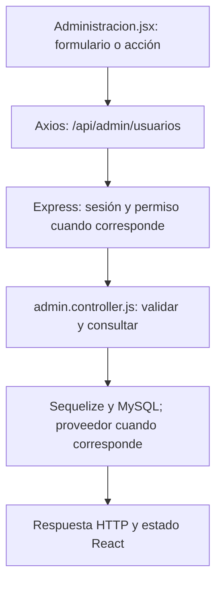

# Iván Lerner · guía de la entrega final

**Responsabilidad:** Entrenamientos, creación de dietas y altas administrativas.

Conservás entrenamientos e ingreso manual de dietas. Sumás el listado/buscador y alta de usuarios del panel, sin cambiar la sesión del administrador.

Este documento asigna estudio, revisión y defensa. No certifica autoría pasada. Antes de exponer, completá las comprobaciones de tu recorrido.

## Primero: base común que puede preguntar el profesor

Leé [BASE-COMUN.md](../docs/BASE-COMUN.md). Son conceptos breves que todos deben entender: carpetas, login, Bcrypt, JWT, middleware, CORS, useState y useEffect. El PDF permite preguntas sobre código de compañeros; no hay garantía de que limite la defensa a este módulo. El detalle profundo que sigue es tu parte.

## Mapa de tu módulo

## Tus endpoints y continuidad

| Etapa | Método y ruta | Handler real |
| --- | --- | --- |
| Base del 50 % | `GET /api/entrenamientos` | [listarEntrenamientos](../backend/controllers/entrenamientos.controller.js#L8) |
| Base del 50 % | `POST /api/entrenamientos` | [iniciarEntrenamiento](../backend/controllers/entrenamientos.controller.js#L39) |
| Base del 50 % | `PUT /api/entrenamientos/:id` | [actualizarRegistro](../backend/controllers/entrenamientos.controller.js#L140) |
| Avance nuevo | `POST /api/dietas` | [actualizarDieta](../backend/controllers/nutricion.controller.js#L152) |

## Funciones concretas del avance

| Función | Qué parte recorrés |
| --- | --- |
| [actualizarDieta](../backend/controllers/nutricion.controller.js#L152) | Tu rama principal es crear sin req.params.id. Las validaciones generales y la transacción se revisan con Paulo. |
| [guardar](../client/src/pages/Nutricion.jsx) | Tu recorrido termina en POST /dietas sin editando; no incluye consumos. |

Los helpers son funciones internas, no endpoints adicionales. Si una función sirve a POST y PUT o a generación y adaptación, se revisa entre los dos responsables. No hay que duplicarla ni separarla artificialmente para aparentar más código.

## Entradas, consultas y respuestas de tus rutas

### `GET /api/entrenamientos`

**Qué recibe.** Sin body ni filtros por fecha en el endpoint actual.

**Qué ejecuta y consulta.** `Entrenamiento.findAll` propio con `include` de `EntrenamientoEjercicio`, con `order` que pide a MySQL inicio descendente y posición ascendente de los detalles. No usa `for...of` ni `sort((a,b) => ...)` para reordenarlos después.

**Qué valida o decide.** Devuelve también el iniciado. El frontend separa la sesión en curso del historial cerrado.

**Respuesta correcta.** `200` → `{items: [...]}` con los ejercicios registrados.

**Errores propios.** `500` si no puede consultar.

**Quién lo llama.** Entrenamientos.jsx: `cargar`.

**Cómo mostrarlo.** Mostrar dónde está Tu historial y distinguir una sesión iniciada de una ya cerrada.

### `POST /api/entrenamientos`

**Qué recibe.** Body: `rutina_id` y `dia_semana` entero 1–7.

**Qué ejecuta y consulta.** Busca `Rutina` propia activa, sus `RutinaEjercicio` del día y otra sesión abierta. En una transacción crea `Entrenamiento` y copias `EntrenamientoEjercicio`.

**Qué valida o decide.** Debe haber ejercicios para ese día. Un usuario tiene como máximo una sesión iniciada; `usuario_en_curso` único refuerza esa regla. Fecha del día según zona de la cuenta.

**Respuesta correcta.** `201` → cabecera de la sesión; la pantalla vuelve a listar para obtener los detalles.

**Errores propios.** `400` por datos o día sin ejercicios; `404` por rutina ajena/inexistente/inactiva; `409` por sesión ya abierta; `500` si falla.

**Quién lo llama.** Entrenamientos.jsx: `iniciar`; antes consulta las rutinas con un endpoint de otro responsable.

**Cómo mostrarlo.** Elegir rutina y lunes; iniciar y explicar por qué se copian ejercicios en lugar de leer siempre el plan original.

### `PUT /api/entrenamientos/:id`

**Qué recibe.** URL `id`; body: `estado`, todos los `ejercicios`, `observaciones` string, `distancia_km` numérico; `confirmar: true` si cierra. Cada ejercicio lleva `id`, `realizado` booleano, `series`, `repeticiones`, `peso_utilizado_kg`.

**Qué ejecuta y consulta.** Busca la sesión propia y sus detalles. En una transacción vuelve a leer/bloquear la sesión, actualiza `EntrenamientoEjercicio` y después cabecera, fin y `usuario_en_curso`.

**Qué valida o decide.** Estado iniciado/completado/incompleto/cancelado. Deben venir exactamente los ids propios, sin repetidos. Completo requiere todos realizados; incompleto al menos uno. Cerrado no admite otra edición.

**Respuesta correcta.** `200` → `{message: "Entrenamiento guardado."}`; no devuelve la sesión completa.

**Errores propios.** `400` por registro inválido o falta de confirmar; `404` por sesión ajena/inexistente; `409` por cierre previo/concurrente; `500` por fallo.

**Quién lo llama.** Entrenamientos.jsx: `guardar(estado)`; cambiar entradas solo modifica estado local hasta guardar.

**Cómo mostrarlo.** Guardar avance, marcar realizado y cerrar completo con confirmación; explicar por qué después ya no se edita.

### `POST /api/dietas`

**Qué recibe.** Body: `nombre`, `descripcion` string, `calorias_objetivo`, `proteinas_objetivo_g`, `carbohidratos_objetivo_g`, `grasas_objetivo_g`, `comidas` (1–15); `objetivo_id` opcional. Cada comida: `nombre_comida`, `tipo_comida`, `hora` HH:mm, `alimentos` (1–30). Cada alimento: `nombre`, `cantidad`, `unidad` g/ml/porcion, `calorias`, `proteinas_g`, `carbohidratos_g`, `grasas_g` por 100 g/ml o una porción.

**Qué ejecuta y consulta.** Consulta el objetivo si corresponde. En una transacción crea `Dieta` tipo manual e inserta `DietaComida` mediante `actualizarComida`. Los alimentos se conservan como JSON dentro de cada comida.

**Qué valida o decide.** Metas numéricas 0–9000 (kcal enteras); nombres, tipos de comida y horarios válidos. `calcularMacros` recalcula desde alimentos y cantidades. Un objetivo nuevo asociado debe ser propio y activo.

**Respuesta correcta.** `201` → cabecera creada; la interfaz recarga GET /api/dietas para detalles.

**Errores propios.** `400` por entradas, alimentos, horario u objetivo inválidos; `500` si no puede guardar.

**Quién lo llama.** Nutricion.jsx modo dietas: `guardar` sin id editando.

**Cómo mostrarlo.** Crear un plan con desayuno y un alimento; mostrar que no suma automáticamente al consumo del día.

## Lo que se agrega en el cierre

`listarUsuarios`: toma q acotado, construye condiciones LIKE, incluye roles, limita a 200 resultados y proyecta datos públicos. No devuelve hashes ni teléfonos. `crearUsuario`: valida datos, bcrypt y transacción para Usuario/UsuarioRol/bitácora; no llama a abrirSesion ni reemplaza la cookie del administrador. `guardarUsuario` en Administración hace POST cuando no hay editando; luego refresca la lista y limpia los campos. Continuás sabiendo explicar `iniciarEntrenamiento` y `actualizarRegistro`: se copia la rutina a registros propios y las ediciones futuras no reescriben el historial.

### Rutas nuevas que defendés

| Método y ruta | Función | Archivo |
| --- | --- | --- |
| `GET /api/admin/usuarios` | `listarUsuarios` | [admin.controller.js](../backend/controllers/admin.controller.js) |
| `POST /api/admin/usuarios` | `crearUsuario` | [admin.controller.js](../backend/controllers/admin.controller.js) |

## Preguntas de defensa con respuesta orientativa

**¿Por qué copiar ejercicios al iniciar?** El historial debe conservar lo que se hizo aunque se edite la rutina después.

**¿Para qué una transacción al crear usuario?** Usuario y su rol deben existir juntos. Si falla un paso se revierte para no dejar una cuenta incompleta.

**¿Crear desde admin inicia sesión como ese usuario?** No. Se crea la cuenta y se conserva la cookie y sesión del administrador.

## Práctica equivalente para los nueve

- [ ] Recorrer una acción desde el componente hasta MySQL y volver con la respuesta.
- [ ] Mostrar un caso correcto con datos de prueba y persistencia comprobada.
- [ ] Mostrar un caso de datos inválidos y explicar el código HTTP.
- [ ] Mostrar un caso de autorización, cancelación o estado no permitido; no debe cambiar información.
- [ ] Explicar el formulario, las funciones principales, las librerías y el diagrama sin leer código palabra por palabra.
- [ ] Hacer una modificación pequeña y explicar el resultado (por ejemplo un texto, un límite válido o un campo).

## Ensayo individual de 15–20 minutos

2 minutos: ubicar backend/client y tu componente. 5 minutos: seguir una petición propia. 4 minutos: explicar modelo y validaciones. 4 minutos: demostrar éxito/error/cancelación. 3 minutos: responder las preguntas anteriores y los conceptos comunes. No memorizar respuestas sobre funciones que no revisaste.

## Archivos compartidos y continuidad

`backend/index.js` monta las rutas y sirve React; `backend/config/db.js` conecta Sequelize; `backend/models/index.js` relaciona modelos; `client/src/App.jsx` decide navegación y sesión. La base de estos archivos se revisa entre todos. Compartir un archivo no significa que cada persona deba defender todas sus ramas internas: ubicá tu método y seguí sus llamadas.

El reparto final sustituye las estimaciones de carga del corte 75. Cada integrante tiene un paquete completo y la misma lista de comprobaciones; no son porcentajes medidos de autoría ni horas reales.
