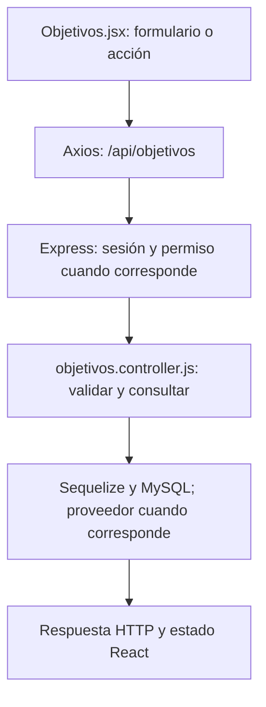

# Paulo López Stanley · guía de la entrega final

**Responsabilidad:** Objetivos y su frontend completo.

Se te asigna expresamente el frontend completo de Objetivos (Objetivos.jsx), además de sus endpoints y la edición de dietas que ya conservabas. Sumás la edición de datos de usuarios en Administración. Esta asignación no certifica quién escribió cada línea en el pasado.

Este documento asigna estudio, revisión y defensa. No certifica autoría pasada. Antes de exponer, completá las comprobaciones de tu recorrido.

## Primero: base común que puede preguntar el profesor

Leé [BASE-COMUN.md](../docs/BASE-COMUN.md). Son conceptos breves que todos deben entender: carpetas, login, Bcrypt, JWT, middleware, CORS, useState y useEffect. El PDF permite preguntas sobre código de compañeros; no hay garantía de que limite la defensa a este módulo. El detalle profundo que sigue es tu parte.

## Mapa de tu módulo

## Tus endpoints y continuidad

| Etapa | Método y ruta | Handler real |
| --- | --- | --- |
| Base del 50 % | `GET /api/objetivos` | [visuaizarObjetivo](../backend/controllers/objetivos.controller.js#L4) |
| Base del 50 % | `POST /api/objetivos` | [definirObjeto](../backend/controllers/objetivos.controller.js#L27) |
| Base del 50 % | `POST /api/objetivos/:id/completar` | [marcarCompletado](../backend/controllers/objetivos.controller.js#L206) |
| Base del 50 % | `DELETE /api/objetivos/:id` | [eliminarObjetivo](../backend/controllers/objetivos.controller.js#L246) |
| Avance nuevo | `PUT /api/dietas/:id` | [actualizarDieta](../backend/controllers/nutricion.controller.js#L152) |

## Funciones concretas del avance

| Función | Qué parte recorrés |
| --- | --- |
| [actualizarDieta](../backend/controllers/nutricion.controller.js#L152) | Tu rama principal busca la dieta propia por id y reemplaza cabecera/detalles dentro de una transacción. |
| [editar](../client/src/pages/Nutricion.jsx) | Tu rama carga una dieta existente. |
| [copiarComidas](../client/src/pages/Nutricion.jsx) | Revisión compartida con Simón de la copia de listas, sin mutar el original. |
| [guardar](../client/src/pages/Nutricion.jsx) | Tu recorrido usa PUT /dietas/:id con editando. |

Los helpers son funciones internas, no endpoints adicionales. Si una función sirve a POST y PUT o a generación y adaptación, se revisa entre los dos responsables. No hay que duplicarla ni separarla artificialmente para aparentar más código.

## Entradas, consultas y respuestas de tus rutas

### `GET /api/objetivos`

**Qué recibe.** Sin body.

**Qué ejecuta y consulta.** `Objetivo.findAll` por usuario, excluye estado eliminado y ordena por fecha de inicio/id descendentes.

**Qué valida o decide.** Se conserva la grafía `visuaizarObjetivo` del UML. Listar no calcula el porcentaje; eso corresponde a `/progreso`.

**Respuesta correcta.** `200` → `{items: [...]}` con objetivos activos y completados.

**Errores propios.** `500` si no puede listar.

**Quién lo llama.** Objetivos.jsx: `cargar`. Rutinas.jsx y, en el 75, Nutricion.jsx también consultan este endpoint para sus selectores.

**Cómo mostrarlo.** Mostrar un objetivo activo y otro completado; explicar qué registros se excluyen.

### `POST /api/objetivos`

**Qué recibe.** Body: `nombre`, `tipo`, `valor_objetivo` numérico, `unidad`, `fecha_inicio`; opcionales `descripcion`, `frecuencia_semanal`, `fecha_fin_estimada`.

**Qué ejecuta y consulta.** Busca la última `MedicionFisica` y un posible `Objetivo` activo. Crea el objetivo con línea de base, medición vinculada y `usuario_activo`; registra `Bitacora`.

**Qué valida o decide.** Un único activo. Tipos: bajar_peso, ganar_masa_muscular, mejorar_resistencia, aumentar_frecuencia_entrenamiento, definir, mantener_peso. kg/%/km/entrenamientos deben corresponder al tipo; fechas válidas y fin no anterior al inicio.

**Respuesta correcta.** `201` → objetivo creado.

**Errores propios.** `400` por datos, unidad o meta incoherentes; `409` por falta de medidas u objetivo activo existente; `500` si falla.

**Quién lo llama.** Objetivos.jsx: `guardar`.

**Cómo mostrarlo.** Crear una meta coherente con la medición y explicar la línea de base y el rechazo de una segunda meta activa.

### `POST /api/objetivos/:id/completar`

**Qué recibe.** URL: `id` del objetivo. Body: `confirmar: true`.

**Qué ejecuta y consulta.** Busca `Objetivo` propio por id y actualiza estado a completado, libera `usuario_activo`, guarda fecha visible y `fecha_cierre` exacta; registra `Bitacora`.

**Qué valida o decide.** Solo admite un objetivo activo. No comprueba que el porcentaje medido haya llegado a 100: completar es una decisión manual.

**Respuesta correcta.** `200` → objetivo actualizado.

**Errores propios.** `400` sin confirmación; `404` si no es propio/no existe; `409` si ya no está activo; `500` si falla.

**Quién lo llama.** Objetivos.jsx: `cambiar(o, true)`.

**Cómo mostrarlo.** Cancelar primero y después completar una meta de prueba; explicar por qué el momento de cierre se conserva.

### `DELETE /api/objetivos/:id`

**Qué recibe.** URL: `id`. Body: `confirmar: true`.

**Qué ejecuta y consulta.** Busca el objetivo propio, cambia estado a eliminado y libera `usuario_activo`; registra `Bitacora`. No destruye la fila ni las referencias históricas de los planes.

**Qué valida o decide.** Es una baja lógica y exige confirmación.

**Respuesta correcta.** `204` sin JSON.

**Errores propios.** `400` sin confirmación; `404` si no pertenece a la cuenta/no existe; `409` si ya estaba eliminado; `500` por fallo.

**Quién lo llama.** Objetivos.jsx: `cambiar(o, false)`.

**Cómo mostrarlo.** Explicar la diferencia entre dejar de mostrar una meta y borrar una cuenta definitivamente.

### `PUT /api/dietas/:id`

**Qué recibe.** URL `id` y body completo del POST /api/dietas.

**Qué ejecuta y consulta.** Busca `Dieta` propia activa. En una transacción actualiza cabecera, destruye sus `DietaComida` antiguas y crea el conjunto nuevo; no modifica `ComidaConsumida`.

**Qué valida o decide.** Metas numéricas 0–9000 (kcal enteras); nombres, tipos de comida y horarios válidos. `calcularMacros` recalcula desde alimentos y cantidades. Un objetivo nuevo asociado debe ser propio y activo. Puede mantener el mismo objetivo histórico completado que ya tenía asociado.

**Respuesta correcta.** `200` → cabecera actualizada.

**Errores propios.** `400` datos inválidos; `404` si no hay dieta propia activa; `500` por fallo.

**Quién lo llama.** Nutricion.jsx modo dietas: `editar` carga el formulario y `guardar` elige PUT.

**Cómo mostrarlo.** Cambiar horario y cantidad, guardar y explicar que los consumos previos conservan sus valores.

## Lo que se agrega en el cierre

En `Objetivos.jsx`, `cargar` llama GET /objetivos, y useEffect lo ejecuta al montar. `guardar` evita recargar la página con preventDefault, convierte valores numéricos y envía POST; `cambiar` prepara la confirmación y luego completa por POST o elimina por DELETE. `datos` contiene el formulario, `items` el historial, `ocupado` bloquea botones y `aviso` muestra respuestas. `unidad` depende del tipo de objetivo. `hayObjetivoActivo` impide ofrecer una segunda meta activa; la base también tiene usuario_activo único. Los inputs controlados usan value/onChange y setDatos con una copia explícita para no perder campos. `.map()` solo construye elementos JSX con key; el backend conserva for e if. `editarUsuario` en backend permite nombre, apellido y correo, sin aceptar roles ni contraseña por ese endpoint. El frontend del panel reutiliza el formulario con editando; PUT conserva el id.

### Rutas nuevas que defendés

| Método y ruta | Función | Archivo |
| --- | --- | --- |
| `PUT /api/admin/usuarios/:id` | `editarUsuario` | [admin.controller.js](../backend/controllers/admin.controller.js) |

## Preguntas de defensa con respuesta orientativa

**¿Qué diferencia hay entre useState y useEffect?** useState conserva formulario/listado/avisos entre renderizados. useEffect ejecuta la carga de datos al montar; no guarda datos en MySQL.

**¿Por qué Number antes de POST?** Los inputs entregan strings; el backend exige números reales. El frontend ayuda y el servidor vuelve a validar.

**¿Por qué confirmar antes de completar o borrar?** Confirmar inicia la escritura; cancelar cierra el diálogo sin enviar la petición que cambia datos. El backend exige confirmar:true.

## Práctica equivalente para los nueve

- [ ] Recorrer una acción desde el componente hasta MySQL y volver con la respuesta.
- [ ] Mostrar un caso correcto con datos de prueba y persistencia comprobada.
- [ ] Mostrar un caso de datos inválidos y explicar el código HTTP.
- [ ] Mostrar un caso de autorización, cancelación o estado no permitido; no debe cambiar información.
- [ ] Explicar el formulario, las funciones principales, las librerías y el diagrama sin leer código palabra por palabra.
- [ ] Hacer una modificación pequeña y explicar el resultado (por ejemplo un texto, un límite válido o un campo).

## Ensayo individual de 15–20 minutos

2 minutos: ubicar backend/client y tu componente. 5 minutos: seguir una petición propia. 4 minutos: explicar modelo y validaciones. 4 minutos: demostrar éxito/error/cancelación. 3 minutos: responder las preguntas anteriores y los conceptos comunes. No memorizar respuestas sobre funciones que no revisaste.

## Archivos compartidos y continuidad

`backend/index.js` monta las rutas y sirve React; `backend/config/db.js` conecta Sequelize; `backend/models/index.js` relaciona modelos; `client/src/App.jsx` decide navegación y sesión. La base de estos archivos se revisa entre todos. Compartir un archivo no significa que cada persona deba defender todas sus ramas internas: ubicá tu método y seguí sus llamadas.

El reparto final sustituye las estimaciones de carga del corte 75. Cada integrante tiene un paquete completo y la misma lista de comprobaciones; no son porcentajes medidos de autoría ni horas reales.
