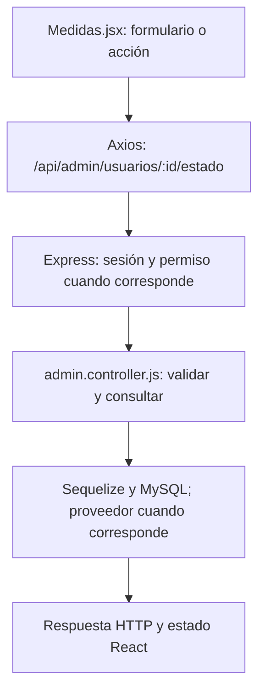

# Gade Silva y Lápiz · guía de la entrega final

**Responsabilidad:** Medidas, consumos y habilitación de cuentas.

Conservás medidas y alta de consumos/alimentos. Sumás bloqueo/activación y reemplazo de roles por usuario, comprobando revocación de sesiones y protección del último administrador.

Este documento asigna estudio, revisión y defensa. No certifica autoría pasada. Antes de exponer, completá las comprobaciones de tu recorrido.

## Primero: base común que puede preguntar el profesor

Leé [BASE-COMUN.md](../docs/BASE-COMUN.md). Son conceptos breves que todos deben entender: carpetas, login, Bcrypt, JWT, middleware, CORS, useState y useEffect. El PDF permite preguntas sobre código de compañeros; no hay garantía de que limite la defensa a este módulo. El detalle profundo que sigue es tu parte.

## Mapa de tu módulo

## Tus endpoints y continuidad

| Etapa | Método y ruta | Handler real |
| --- | --- | --- |
| Base del 50 % | `GET /api/mediciones` | [listarMediciones](../backend/controllers/mediciones.controller.js#L204) |
| Base del 50 % | `POST /api/mediciones/initial` | [actualizarMedicion](../backend/controllers/mediciones.controller.js#L55) |
| Base del 50 % | `POST /api/mediciones` | [actualizarMedicion](../backend/controllers/mediciones.controller.js#L55) |
| Avance nuevo | `POST /api/consumos` | [registrarComida](../backend/controllers/nutricion.controller.js#L370) |

## Funciones concretas del avance

| Función | Qué parte recorrés |
| --- | --- |
| [registrarComida](../backend/controllers/nutricion.controller.js#L370) | Tu rama crea un consumo sin id y recalcula nutrientes. |
| [copiarAlimento](../client/src/pages/Nutricion.jsx) | Copia explícita de los campos de un alimento. |
| [agregarAlimento](../client/src/pages/Nutricion.jsx) | Agrega un alimento al editor común. |
| [actualizarComida](../backend/controllers/nutricion.controller.js#L102) | Revisión conjunta con Valentín: la misma comida validada se persiste como detalle de dieta. |

Los helpers son funciones internas, no endpoints adicionales. Si una función sirve a POST y PUT o a generación y adaptación, se revisa entre los dos responsables. No hay que duplicarla ni separarla artificialmente para aparentar más código.

## Entradas, consultas y respuestas de tus rutas

### `GET /api/mediciones`

**Qué recibe.** Sin body ni query.

**Qué ejecuta y consulta.** `MedicionFisica.findAll` por `usuario_id`, ordenado por `fecha_medicion DESC`.

**Qué valida o decide.** No acepta un usuario_id del navegador para consultar otra cuenta.

**Respuesta correcta.** `200` → `{items: [...]}`; puede estar vacío.

**Errores propios.** `500` si no puede consultar.

**Quién lo llama.** Medidas.jsx: `cargar`.

**Cómo mostrarlo.** Mostrar el historial con dos registros, indicando cuál es el más reciente.

### `POST /api/mediciones/initial`

**Qué recibe.** Body: `peso_kg`, `altura_cm`, `nivel_actividad`; opcionales `grasa_corporal`, `musculo_corporal`, `fecha_medicion`, `cintura_cm`, `pecho_cm`, `brazos_cm`, `piernas_cm`.

**Qué ejecuta y consulta.** Busca la última medición propia; si no existe crea `MedicionFisica` con `usuario_inicial = req.user.id` y registra `Bitacora`.

**Qué valida o decide.** La función detecta la ruta `/initial`. Rechaza una segunda carga inicial. Peso 20–400 kg, altura 80–250 cm, grasa 0–70 %, músculo 0–100 %, suma de porcentajes ≤100; actividad baja/media/alta. Fecha no futura; perímetros mayores que 0 y hasta 300 cm.

**Respuesta correcta.** `201` → fila de medición creada.

**Errores propios.** `400` por valores/fechas inválidos; `409` si ya existe inicial; `500` si no puede guardar.

**Quién lo llama.** Medidas.jsx: `guardar` elige `/mediciones/initial` cuando la lista está vacía.

**Cómo mostrarlo.** Registrar el punto de partida; explicar por qué este endpoint no se usa de nuevo.

### `POST /api/mediciones`

**Qué recibe.** Body: `peso_kg`, `altura_cm`, `nivel_actividad`; opcionales `grasa_corporal`, `musculo_corporal`, `fecha_medicion`, `cintura_cm`, `pecho_cm`, `brazos_cm`, `piernas_cm`.

**Qué ejecuta y consulta.** Busca la última medición propia; crea otra fila de `MedicionFisica` y agrega `Bitacora`, sin sobrescribir la anterior.

**Qué valida o decide.** Debe haber una medición previa y la nueva fecha debe ser posterior. Peso 20–400 kg, altura 80–250 cm, grasa 0–70 %, músculo 0–100 %, suma de porcentajes ≤100; actividad baja/media/alta. Fecha no futura; perímetros mayores que 0 y hasta 300 cm.

**Respuesta correcta.** `201` → nueva fila del historial.

**Errores propios.** `400` por datos o fecha no posterior; `409` si todavía falta la inicial; `500` si falla el guardado.

**Quién lo llama.** Medidas.jsx: `guardar` elige `/mediciones` si ya hay registros.

**Cómo mostrarlo.** Agregar una medición posterior y mostrar que conserva la inicial.

### `POST /api/consumos`

**Qué recibe.** Body: `nombre_comida`, `tipo_comida`, `fecha_consumo` como instante ISO y `alimentos` (1–30). Cada alimento incluye nombre, cantidad, unidad g/ml/porcion y sus calorías/proteínas/carbohidratos/grasas por 100 g/ml o una porción.

**Qué ejecuta y consulta.** `datosComida` llama a `calcularMacros`; crea una fila `ComidaConsumida` con propietario, instante, copia de alimentos y totales.

**Qué valida o decide.** Fecha válida desde el año 2000 y no futura. Se recalculan totales en el servidor; un total enviado aparte por el cliente no reemplaza este cálculo. Cantidades positivas y nutrientes válidos.

**Respuesta correcta.** `201` → consumo creado con `calorias_totales`, `proteinas_totales_g`, `carbohidratos_totales_g`, `grasas_totales_g`.

**Errores propios.** `400` por alimento, cantidad o fecha inválidos; `500` si falla.

**Quién lo llama.** Nutricion.jsx modo consumos: `guardar` sin id editando; vacío en fecha/hora del formulario se convierte al instante actual antes de enviar.

**Cómo mostrarlo.** Ingresar 50 g de un alimento de 400 kcal/100 g y comprobar que registra 200 kcal.

## Lo que se agrega en el cierre

`activarUsuario` y `bloquearUsuario` fijan el estado del recorrido y llaman `cambiarEstado`; este exige confirmar, busca la cuenta, protege el último administrador activo y actualiza bajo transacción. Al bloquear elimina Sesion, por eso el JWT anterior deja de servir aunque aún no haya vencido. `asignarRoles` comprueba ids válidos y no repetidos, bloquea el rol Administrador para serializar cambios, exige que quede un admin activo, reemplaza UsuarioRol y revoca sesiones. `cambiarEstado` no crea usuarios ni restaura una cuenta borrada. Las validaciones físicas y de alimentos conservan los límites del 75 %.

### Rutas nuevas que defendés

| Método y ruta | Función | Archivo |
| --- | --- | --- |
| `PATCH /api/admin/usuarios/:id/estado` | `activarUsuario` | [admin.controller.js](../backend/controllers/admin.controller.js) |
| `PUT /api/admin/usuarios/:id/roles` | `asignarRoles` | [admin.controller.js](../backend/controllers/admin.controller.js) |

## Preguntas de defensa con respuesta orientativa

**¿Bloquear elimina datos?** No. Cambia estado a bloqueado y revoca sesiones; activar vuelve a habilitar el login.

**¿Por qué el estado no se valida solo en React?** Se puede llamar la API sin la pantalla. El middleware y controlador deben comprobar autorización y datos.

**¿Qué impide quitar el último admin?** Una transacción bloquea el rol del sistema y comprueba cuántos administradores activos quedan antes de modificarlo.

## Práctica equivalente para los nueve

- [ ] Recorrer una acción desde el componente hasta MySQL y volver con la respuesta.
- [ ] Mostrar un caso correcto con datos de prueba y persistencia comprobada.
- [ ] Mostrar un caso de datos inválidos y explicar el código HTTP.
- [ ] Mostrar un caso de autorización, cancelación o estado no permitido; no debe cambiar información.
- [ ] Explicar el formulario, las funciones principales, las librerías y el diagrama sin leer código palabra por palabra.
- [ ] Hacer una modificación pequeña y explicar el resultado (por ejemplo un texto, un límite válido o un campo).

## Ensayo individual de 15–20 minutos

2 minutos: ubicar backend/client y tu componente. 5 minutos: seguir una petición propia. 4 minutos: explicar modelo y validaciones. 4 minutos: demostrar éxito/error/cancelación. 3 minutos: responder las preguntas anteriores y los conceptos comunes. No memorizar respuestas sobre funciones que no revisaste.

## Archivos compartidos y continuidad

`backend/index.js` monta las rutas y sirve React; `backend/config/db.js` conecta Sequelize; `backend/models/index.js` relaciona modelos; `client/src/App.jsx` decide navegación y sesión. La base de estos archivos se revisa entre todos. Compartir un archivo no significa que cada persona deba defender todas sus ramas internas: ubicá tu método y seguí sus llamadas.

El reparto final sustituye las estimaciones de carga del corte 75. Cada integrante tiene un paquete completo y la misma lista de comprobaciones; no son porcentajes medidos de autoría ni horas reales.
