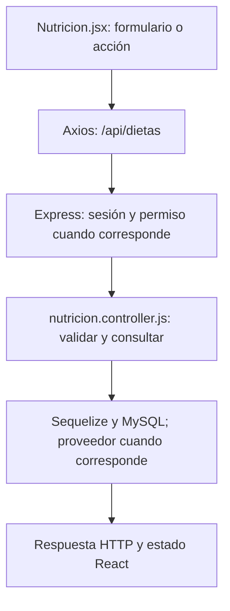

# Valentín Sued (Sueco) · guía de la entrega final

**Responsabilidad:** Rutinas manuales y gestión de dietas.

Conservás escritura/baja de rutinas, consulta/baja de dietas y editor de comidas. Integrás la presentación de comidas y sus alimentos generados por IA y revisás eliminación de roles no asignados.

Este documento asigna estudio, revisión y defensa. No certifica autoría pasada. Antes de exponer, completá las comprobaciones de tu recorrido.

## Primero: base común que puede preguntar el profesor

Leé [BASE-COMUN.md](../docs/BASE-COMUN.md). Son conceptos breves que todos deben entender: carpetas, login, Bcrypt, JWT, middleware, CORS, useState y useEffect. El PDF permite preguntas sobre código de compañeros; no hay garantía de que limite la defensa a este módulo. El detalle profundo que sigue es tu parte.

## Mapa de tu módulo

## Tus endpoints y continuidad

| Etapa | Método y ruta | Handler real |
| --- | --- | --- |
| Base del 50 % | `POST /api/rutinas` | [actualizarRutina](../backend/controllers/rutinas.controller.js#L229) |
| Base del 50 % | `PUT /api/rutinas/:id` | [actualizarRutina](../backend/controllers/rutinas.controller.js#L229) |
| Base del 50 % | `DELETE /api/rutinas/:id` | [eliminarRutina](../backend/controllers/rutinas.controller.js#L324) |
| Avance nuevo | `GET /api/dietas` | [listarDietas](../backend/controllers/nutricion.controller.js#L129) |
| Avance nuevo | `DELETE /api/dietas/:id` | [eliminarDieta](../backend/controllers/nutricion.controller.js#L340) |

## Funciones concretas del avance

| Función | Qué parte recorrés |
| --- | --- |
| [listarDietas](../backend/controllers/nutricion.controller.js#L129) | Consulta propia con detalles. |
| [eliminarDieta](../backend/controllers/nutricion.controller.js#L340) | Baja lógica confirmada; no suma ni borra consumos. |
| [copiarComida](../client/src/pages/Nutricion.jsx) | Copia los campos de una comida del editor. |
| [actualizarComidas](../client/src/pages/Nutricion.jsx) | Actualiza la colección de comidas sin mutar estado. |
| [agregarComida](../client/src/pages/Nutricion.jsx) | Agrega una comida nueva al plan. |
| [quitarComida](../client/src/pages/Nutricion.jsx) | Quita una comida elegida del editor. |
| [actualizarComida](../backend/controllers/nutricion.controller.js#L102) | Detalle de dieta; revisión conjunta con Gade, que maneja alimentos compartidos. |

Los helpers son funciones internas, no endpoints adicionales. Si una función sirve a POST y PUT o a generación y adaptación, se revisa entre los dos responsables. No hay que duplicarla ni separarla artificialmente para aparentar más código.

## Entradas, consultas y respuestas de tus rutas

### `POST /api/rutinas`

**Qué recibe.** Body: `nombre`, `ejercicios` (1–80); opcionales `descripcion`, `objetivo_id`. Cada ejercicio: `nombre_ejercicio` o `ejercicio_id` del catálogo, `dia_semana` (1–7), `series`, `repeticiones`, `peso_sugerido_kg`, `descanso_segundos`; opcionales `orden` y `observaciones`.

**Qué ejecuta y consulta.** Consulta `Objetivo` si se vinculó. `guardarRutina` crea `Rutina` y `actualizarRutinaEjercicio` inserta las filas `RutinaEjercicio`, todo en una transacción.

**Qué valida o decide.** Nombre 2–100; series 1–20; repeticiones 1–200; carga 0–600; descanso entero 0–900; posición no repetida por día. Si hay id del catálogo, el servidor toma su nombre/grupo. Un objetivo nuevo debe ser propio y activo.

**Respuesta correcta.** `201` → cabecera de la rutina; para ver ejercicios completos se vuelve a consultar `GET /api/rutinas`.

**Errores propios.** `400` por cabecera, ejercicio u objetivo inválido; `500` si falla el guardado.

**Quién lo llama.** Rutinas.jsx: `guardar` sin `editando`; calcula `orden` al recorrer la lista.

**Cómo mostrarlo.** Crear una rutina con un ejercicio manual y otro del catálogo; explicar cómo se guarda cabecera y detalle.

### `PUT /api/rutinas/:id`

**Qué recibe.** URL `id` + el mismo body completo que POST /api/rutinas. No es una edición parcial.

**Qué ejecuta y consulta.** Busca `Rutina` propia activa y objetivo si corresponde. En una transacción actualiza cabecera, elimina sus antiguos `RutinaEjercicio` e inserta el nuevo conjunto.

**Qué valida o decide.** Nombre 2–100; series 1–20; repeticiones 1–200; carga 0–600; descanso entero 0–900; posición no repetida por día. Si hay id del catálogo, el servidor toma su nombre/grupo. Un objetivo nuevo debe ser propio y activo. Puede conservar el mismo objetivo histórico ya asociado aunque esté completado. Los ejercicios de entrenamientos iniciados antes son copias independientes.

**Respuesta correcta.** `200` → cabecera actualizada; la pantalla recarga el listado.

**Errores propios.** `400` por datos/objetivo inválidos; `404` si no hay rutina propia activa; `500` por fallo.

**Quién lo llama.** Rutinas.jsx: `editar` llena el formulario y `guardar` usa PUT cuando hay id editando.

**Cómo mostrarlo.** Cambiar series, guardar y comprobar que un entrenamiento anterior mantiene lo que tenía registrado.

### `DELETE /api/rutinas/:id`

**Qué recibe.** URL `id`; body `confirmar: true`.

**Qué ejecuta y consulta.** Busca `Rutina` propia activa; busca un `Entrenamiento` iniciado de ese plan. Si no hay, actualiza estado a eliminada y fecha de actualización.

**Qué valida o decide.** Baja lógica: conserva los entrenamientos. No permite dar de baja un plan con sesión abierta.

**Respuesta correcta.** `204` sin JSON.

**Errores propios.** `400` sin confirmar; `404` si no encuentra plan propio activo; `409` si hay entrenamiento en curso; `500` si falla.

**Quién lo llama.** Rutinas.jsx: `eliminar`.

**Cómo mostrarlo.** Intentar la baja durante un entrenamiento y explicar el 409; cerrar antes o cancelar la baja.

### `GET /api/dietas`

**Qué recibe.** Sin body.

**Qué ejecuta y consulta.** `Dieta.findAll` propia, no eliminada, con `include` de `DietaComida`, ordenada por creación descendente.

**Qué valida o decide.** El listado trae comidas y alimentos; no hay endpoint GET /dietas/:id en esta versión. Una dieta planificada no cuenta como consumo.

**Respuesta correcta.** `200` → `{items: [...]}`.

**Errores propios.** `500` si no puede consultar.

**Quién lo llama.** Nutricion.jsx con modo dietas: `cargar`.

**Cómo mostrarlo.** Mostrar las comidas de una dieta y diferenciar sus objetivos de los nutrientes calculados.

### `DELETE /api/dietas/:id`

**Qué recibe.** URL `id`; body `confirmar: true`.

**Qué ejecuta y consulta.** Busca `Dieta` propia activa y actualiza estado a eliminada y fecha de actualización.

**Qué valida o decide.** Baja lógica del plan. No borra alimentos consumidos ni registra que se haya comido nada.

**Respuesta correcta.** `204` sin JSON.

**Errores propios.** `400` sin confirmar; `404` si no hay dieta propia activa; `500` por fallo.

**Quién lo llama.** Nutricion.jsx modo dietas: `eliminar`.

**Cómo mostrarlo.** Cancelar una baja y explicar qué información se conservaría al confirmarla.

## Lo que se agrega en el cierre

En `Nutricion.jsx`, `cargar` distingue dietas de consumos; `editar` carga la cabecera y copia comidas/alimentos sin mutar items. `guardar` usa POST o PUT y `eliminar` requiere Confirmar. `DietaIA.jsx` gestiona preferencias, confirmación y selector de plan: sin id genera, con id adapta. La lista muestra los alimentos, cantidades y unidades, además de los macros. `actualizarDieta` valida toda la cabecera/detalle antes de escribir; al editar elimina y vuelve a crear comidas dentro de la misma transacción. Si la IA interviene, revalida consentimiento y objetivo antes de guardar. `eliminarRol` solo permite borrar roles personalizados que no estén asignados; protege Cliente y Administrador.

### Rutas nuevas que defendés

| Método y ruta | Función | Archivo |
| --- | --- | --- |
| `DELETE /api/admin/roles/:id` | `eliminarRol` | [admin.controller.js](../backend/controllers/admin.controller.js) |

## Preguntas de defensa con respuesta orientativa

**¿Una dieta es lo mismo que un consumo?** No. Dieta es planificación; ComidaConsumida registra lo que ocurrió. El resumen diario suma consumos.

**¿Por qué reemplazar las comidas en una transacción?** Evita cabecera nueva con detalles viejos o una dieta vacía si falla la inserción de una comida.

**¿Por qué no se borra un rol asignado?** Hay usuarios que lo usan. Primero se reemplazan sus asignaciones; roles de sistema no se eliminan.

## Práctica equivalente para los nueve

- [ ] Recorrer una acción desde el componente hasta MySQL y volver con la respuesta.
- [ ] Mostrar un caso correcto con datos de prueba y persistencia comprobada.
- [ ] Mostrar un caso de datos inválidos y explicar el código HTTP.
- [ ] Mostrar un caso de autorización, cancelación o estado no permitido; no debe cambiar información.
- [ ] Explicar el formulario, las funciones principales, las librerías y el diagrama sin leer código palabra por palabra.
- [ ] Hacer una modificación pequeña y explicar el resultado (por ejemplo un texto, un límite válido o un campo).

## Ensayo individual de 15–20 minutos

2 minutos: ubicar backend/client y tu componente. 5 minutos: seguir una petición propia. 4 minutos: explicar modelo y validaciones. 4 minutos: demostrar éxito/error/cancelación. 3 minutos: responder las preguntas anteriores y los conceptos comunes. No memorizar respuestas sobre funciones que no revisaste.

## Archivos compartidos y continuidad

`backend/index.js` monta las rutas y sirve React; `backend/config/db.js` conecta Sequelize; `backend/models/index.js` relaciona modelos; `client/src/App.jsx` decide navegación y sesión. La base de estos archivos se revisa entre todos. Compartir un archivo no significa que cada persona deba defender todas sus ramas internas: ubicá tu método y seguí sus llamadas.

El reparto final sustituye las estimaciones de carga del corte 75. Cada integrante tiene un paquete completo y la misma lista de comprobaciones; no son porcentajes medidos de autoría ni horas reales.
