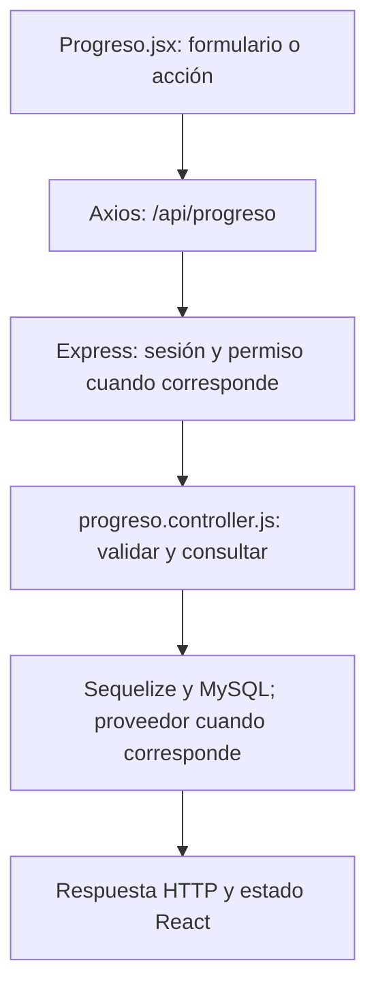

# Mateo Romani · guía de la entrega final

**Responsabilidad:** Progreso, macros y registro de actividad.

Conservás fórmulas de progreso, resumen diario y metas nutricionales. Sumás lectura de bitácora, estados vacíos/errores y conciliación de datos de todos los recorridos de la entrega.

Este documento asigna estudio, revisión y defensa. No certifica autoría pasada. Antes de exponer, completá las comprobaciones de tu recorrido.

## Primero: base común que puede preguntar el profesor

Leé [BASE-COMUN.md](../docs/BASE-COMUN.md). Son conceptos breves que todos deben entender: carpetas, login, Bcrypt, JWT, middleware, CORS, useState y useEffect. El PDF permite preguntas sobre código de compañeros; no hay garantía de que limite la defensa a este módulo. El detalle profundo que sigue es tu parte.

## Mapa de tu módulo

## Tus endpoints y continuidad

| Etapa | Método y ruta | Handler real |
| --- | --- | --- |
| Base del 50 % | `GET /api/progreso` | [verProgreso](../backend/controllers/progreso.controller.js#L25) |
| Avance nuevo | `GET /api/consumos` | [verMacros](../backend/controllers/nutricion.controller.js#L434) |

## Funciones concretas del avance

| Función | Qué parte recorrés |
| --- | --- |
| [verMacros](../backend/controllers/nutricion.controller.js#L434) | Filtra por día local, suma nutrientes y compara con la dieta más reciente. |
| [cargar](../client/src/pages/Nutricion.jsx) | Tu rama consulta GET /consumos cuando cambia el día; el listado de dietas corresponde a Valentín. |
| [verProgreso](../backend/controllers/progreso.controller.js#L25) | Conservás el endpoint de progreso del 50 % y revisás el contador de dietas agregado. |

Los helpers son funciones internas, no endpoints adicionales. Si una función sirve a POST y PUT o a generación y adaptación, se revisa entre los dos responsables. No hay que duplicarla ni separarla artificialmente para aparentar más código.

## Entradas, consultas y respuestas de tus rutas

### `GET /api/progreso`

**Qué recibe.** Sin body ni id de usuario en la URL.

**Qué ejecuta y consulta.** Consulta `MedicionFisica`, `Objetivo` no eliminado, `Entrenamiento` completo y cuenta `Rutina` activa. En el 75 además cuenta `Dieta` activa. Agrupa/calcula valores en JavaScript.

**Qué valida o decide.** `calcularPorcentaje` compara inicio/actual/meta, limita a 0–100 y trata inicio=meta. Resistencia usa mejor distancia; frecuencia cuenta sesiones completas semanales. Objetivos completados cortan en `fecha_cierre`, incluso el mismo día.

**Respuesta correcta.** `200` → `{mediciones, objetivos: [...con valor_actual y porcentaje], entrenamientos_completados, rutinas}`; en 75 agrega `dietas`.

**Errores propios.** `500` si no puede consultar/calcular.

**Quién lo llama.** Progreso.jsx: `useEffect` carga el resumen y Recharts dibuja peso; es la pantalla Resumen, no una pestaña de Mi cuenta.

**Cómo mostrarlo.** Explicar el cálculo 80→70 con actual 75 =50 %, mostrar el gráfico y por qué una meta completada manualmente puede no medir 100 %.

### `GET /api/consumos`

**Qué recibe.** Query opcional: `fecha` YYYY-MM-DD. Si falta usa hoy en la zona horaria de la cuenta.

**Qué ejecuta y consulta.** Lee `ComidaConsumida` propia, filtra cada instante por su día local, suma macros y consulta la `Dieta` activa más reciente para comparar metas.

**Qué valida o decide.** Una fecha ISO inválida devuelve error. El consumo real y el plan no se suman entre sí. Este endpoint calcula totales; no escribe registros.

**Respuesta correcta.** `200` → `{fecha, items, totales: {calorias, proteinas_g, carbohidratos_g, grasas_g}, dieta}`; dieta puede ser null.

**Errores propios.** `400` fecha inválida; `500` si no puede consultar/calcular.

**Quién lo llama.** Nutricion.jsx modo consumos: `cargar` cuando cambia fecha.

**Cómo mostrarlo.** Consultar un día vacío y otro con consumo; explicar cómo 02:30 UTC puede pertenecer al día anterior en Buenos Aires.

## Lo que se agrega en el cierre

`calcularPorcentaje`: (actual−inicial)/(meta−inicial)×100, limita a 0–100 y trata el denominador cero. `verProgreso` combina mediciones, objetivos, entrenamientos completados y fecha de cierre para no alterar metas ya terminadas. `verMacros` filtra consumos por el día de la zona horaria del perfil y suma nutrientes calculados por el servidor; la dieta es una meta, no un consumo. `verBitacora` devuelve los 100 últimos eventos por fecha_hora; en Administración se muestran fecha, módulo, acción y resultado. Bitácora no es historial de chats ni registro de contraseñas. No todos los errores se registran: no prometer auditoría completa ni DVH/DVV.

### Rutas nuevas que defendés

| Método y ruta | Función | Archivo |
| --- | --- | --- |
| `GET /api/admin/bitacora` | `verBitacora` | [admin.controller.js](../backend/controllers/admin.controller.js) |

## Preguntas de defensa con respuesta orientativa

**¿Cómo se calculan macros de 50 g con 400 kcal por 100 g?** 400×50/100=200 kcal; para porciones se divide por 1 en vez de 100.

**¿Qué pasa cuando inicial y meta coinciden?** Se evita dividir por cero; se devuelve 100 solo si el valor actual coincide con esa meta.

**¿Por qué importa la zona horaria?** Un consumo cerca de medianoche puede pertenecer a otro día local; el resumen usa la zona del perfil.

## Práctica equivalente para los nueve

- [ ] Recorrer una acción desde el componente hasta MySQL y volver con la respuesta.
- [ ] Mostrar un caso correcto con datos de prueba y persistencia comprobada.
- [ ] Mostrar un caso de datos inválidos y explicar el código HTTP.
- [ ] Mostrar un caso de autorización, cancelación o estado no permitido; no debe cambiar información.
- [ ] Explicar el formulario, las funciones principales, las librerías y el diagrama sin leer código palabra por palabra.
- [ ] Hacer una modificación pequeña y explicar el resultado (por ejemplo un texto, un límite válido o un campo).

## Ensayo individual de 15–20 minutos

2 minutos: ubicar backend/client y tu componente. 5 minutos: seguir una petición propia. 4 minutos: explicar modelo y validaciones. 4 minutos: demostrar éxito/error/cancelación. 3 minutos: responder las preguntas anteriores y los conceptos comunes. No memorizar respuestas sobre funciones que no revisaste.

## Archivos compartidos y continuidad

`backend/index.js` monta las rutas y sirve React; `backend/config/db.js` conecta Sequelize; `backend/models/index.js` relaciona modelos; `client/src/App.jsx` decide navegación y sesión. La base de estos archivos se revisa entre todos. Compartir un archivo no significa que cada persona deba defender todas sus ramas internas: ubicá tu método y seguí sus llamadas.

El reparto final sustituye las estimaciones de carga del corte 75. Cada integrante tiene un paquete completo y la misma lista de comprobaciones; no son porcentajes medidos de autoría ni horas reales.
