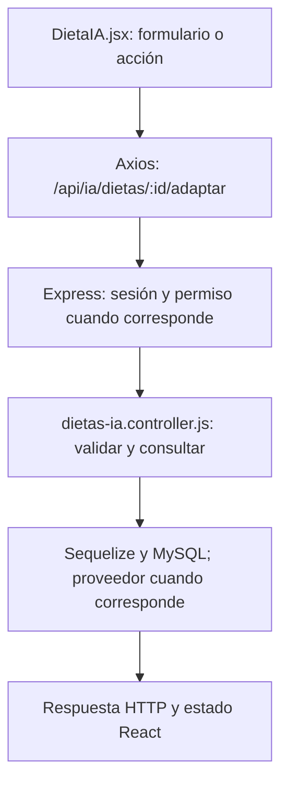

# Joaquín Casanou · guía de la entrega final

**Responsabilidad:** Catálogo y adaptación de planes con IA.

Conservás catálogo, lectura de rutinas y adaptación IA de rutinas. Sumás adaptación de dieta conservando su id y consulta de roles para la pantalla de asignación.

Este documento asigna estudio, revisión y defensa. No certifica autoría pasada. Antes de exponer, completá las comprobaciones de tu recorrido.

## Primero: base común que puede preguntar el profesor

Leé [BASE-COMUN.md](../docs/BASE-COMUN.md). Son conceptos breves que todos deben entender: carpetas, login, Bcrypt, JWT, middleware, CORS, useState y useEffect. El PDF permite preguntas sobre código de compañeros; no hay garantía de que limite la defensa a este módulo. El detalle profundo que sigue es tu parte.

## Mapa de tu módulo

## Tus endpoints y continuidad

| Etapa | Método y ruta | Handler real |
| --- | --- | --- |
| Base del 50 % | `GET /api/ejercicios` | [listarEjercicios](../backend/controllers/rutinas.controller.js#L367) |
| Base del 50 % | `GET /api/rutinas` | [listarRutinas](../backend/controllers/rutinas.controller.js#L177) |
| Avance nuevo | `POST /api/ia/rutinas/:id/adaptar` | [modificarRutinaIA](../backend/controllers/ia.controller.js#L261) |

## Funciones concretas del avance

| Función | Qué parte recorrés |
| --- | --- |
| [modificarRutinaIA](../backend/controllers/ia.controller.js#L261) | Entrada de adaptación; delega al flujo con el id existente. |
| [generarRutinaIA](../backend/controllers/ia.controller.js#L88) | Tu tramo aporta rutina previa y comprueba propiedad; conserva el id al reemplazar ejercicios. |
| [generarRutina](../backend/controllers/ia.controller.js#L52) | Formato de propuesta compartido con Tomás. |
| [generar](../client/src/pages/Asistente.jsx) | Selector de rutina y llamada /adaptar; preparar/confirmar el envío. |

Los helpers son funciones internas, no endpoints adicionales. Si una función sirve a POST y PUT o a generación y adaptación, se revisa entre los dos responsables. No hay que duplicarla ni separarla artificialmente para aparentar más código.

## Entradas, consultas y respuestas de tus rutas

### `GET /api/ejercicios`

**Qué recibe.** Query opcional: `buscar`, `grupo`, `pagina` (desde 1). Sin body.

**Qué ejecuta y consulta.** Carga el JSON local de `models/exercises/exercises.json`; filtra nombre/body_part, arma grupos y corta de a 24. No consulta MySQL para el catálogo; la autenticación sí consultó la sesión.

**Qué valida o decide.** Búsqueda de nombre/grupo en inglés sin distinguir mayúsculas; `grupo` filtra coincidencia exacta. Página limitada a 1–1000. No descarga GIF ni llama una API externa.

**Respuesta correcta.** `200` → `{items, total, pagina, grupos}`.

**Errores propios.** No tiene un error de negocio explícito; aplican autenticación y el error general del servidor si algo inesperado falla.

**Quién lo llama.** Rutinas.jsx: `buscar`, botones de paginación y `agregarFicha`.

**Cómo mostrarlo.** Buscar squat, abrir instrucciones, paginar y agregar una ficha al editor; todavía hay que guardar la rutina.

### `GET /api/rutinas`

**Qué recibe.** Sin body.

**Qué ejecuta y consulta.** `Rutina.findAll` por usuario y estado distinto de eliminada, con `include` de `RutinaEjercicio`. El `order` de Sequelize pide a MySQL rutinas por fecha y ejercicios por día/posición. Un bucle tradicional convierte cada rutina a JSON y normaliza el día a número; ya no hay comparador `sort`.

**Qué valida o decide.** No hay un `GET /rutinas/:id`: este listado ya trae los detalles y la interfaz muestra cada rutina.

**Respuesta correcta.** `200` → `{items: [...]}` con `ejercicios` dentro de cada plan.

**Errores propios.** `500` si no puede consultar.

**Quién lo llama.** Rutinas.jsx: `cargar`; Entrenamientos.jsx lo usa como selector. En el 75 también Asistente.jsx lo consulta para elegir un plan a adaptar.

**Cómo mostrarlo.** Mostrar una rutina completa desde el listado y explicar el include y la ordenación.

### `POST /api/ia/rutinas/:id/adaptar`

**Qué recibe.** Body: `preferencias` de 3–1000 caracteres y `confirmar: true`. Para adaptar, además `id` en la URL.

**Qué ejecuta y consulta.** Busca última `MedicionFisica`, `Objetivo` activo y últimos cinco `Entrenamiento` completos. Pide a Cohere un JSON de plan, valida ejercicios y vuelve a comprobar cuenta/consentimiento/objetivo. `guardarRutina` persiste cabecera y detalles en una transacción. Además busca `Rutina` propia activa con sus ejercicios para el contexto anterior. El handler delega en `generarRutinaIA` usando ese id.

**Qué valida o decide.** Conserva el id del plan y reemplaza su contenido; los entrenamientos históricos no se reescriben. Requiere confirmar el envío y reemplazo.

**Respuesta correcta.** `200` → `{rutina, message}` con el mismo id.

**Errores propios.** `400` por entradas inválidas; `403` sin consentimiento; `404` plan ajeno/inexistente/inactivo; `409` si faltan datos; `503` si falla proveedor/validación/guardado.

**Quién lo llama.** Asistente.jsx: `generar` con una rutina elegida para adaptar.

**Cómo mostrarlo.** Adaptar una rutina de prueba y mostrar el mismo id con ejercicios distintos; contrastar con crear otra rutina.

## Lo que se agrega en el cierre

`modificarRutinaIA` usa el mismo generador de rutinas, pero busca la rutina propia por id; conserva la cabecera y reemplaza ejercicios dentro de transacción. `modificarDietaIA` llama al recorrido común con req.params.id; busca dieta activa propia, prepara comidas anteriores y consumos recientes como contexto y guarda sobre el mismo id. No confundir adaptar con crear: el primero responde 200, el segundo 201. `listarEjercicios` filtra nombre/grupo y pagina de 24 sin necesitar imágenes externas. `listarRoles` devuelve las definiciones existentes, no asigna nada por GET. Los permisos de gestión se comprueban en el middleware.

### Rutas nuevas que defendés

| Método y ruta | Función | Archivo |
| --- | --- | --- |
| `POST /api/ia/dietas/:id/adaptar` | `modificarDietaIA` | [dietas-ia.controller.js](../backend/controllers/dietas-ia.controller.js) |
| `GET /api/admin/roles` | `listarRoles` | [admin.controller.js](../backend/controllers/admin.controller.js) |

## Preguntas de defensa con respuesta orientativa

**¿Adaptar puede crear otra dieta por error?** Con id se exige dieta activa propia. Si no existe responde 404 y no se convierte en alta.

**¿Qué se le envía a Cohere?** Medidas reducidas, meta, preferencias y resumen de plan/historial; no email, teléfono, contraseña ni la clave como contexto.

**¿Por qué paginar el catálogo?** Evita renderizar todo de una vez y permite buscar grupos/nombres con resultados de 24.

## Práctica equivalente para los nueve

- [ ] Recorrer una acción desde el componente hasta MySQL y volver con la respuesta.
- [ ] Mostrar un caso correcto con datos de prueba y persistencia comprobada.
- [ ] Mostrar un caso de datos inválidos y explicar el código HTTP.
- [ ] Mostrar un caso de autorización, cancelación o estado no permitido; no debe cambiar información.
- [ ] Explicar el formulario, las funciones principales, las librerías y el diagrama sin leer código palabra por palabra.
- [ ] Hacer una modificación pequeña y explicar el resultado (por ejemplo un texto, un límite válido o un campo).

## Ensayo individual de 15–20 minutos

2 minutos: ubicar backend/client y tu componente. 5 minutos: seguir una petición propia. 4 minutos: explicar modelo y validaciones. 4 minutos: demostrar éxito/error/cancelación. 3 minutos: responder las preguntas anteriores y los conceptos comunes. No memorizar respuestas sobre funciones que no revisaste.

## Archivos compartidos y continuidad

`backend/index.js` monta las rutas y sirve React; `backend/config/db.js` conecta Sequelize; `backend/models/index.js` relaciona modelos; `client/src/App.jsx` decide navegación y sesión. La base de estos archivos se revisa entre todos. Compartir un archivo no significa que cada persona deba defender todas sus ramas internas: ubicá tu método y seguí sus llamadas.

El reparto final sustituye las estimaciones de carga del corte 75. Cada integrante tiene un paquete completo y la misma lista de comprobaciones; no son porcentajes medidos de autoría ni horas reales.
