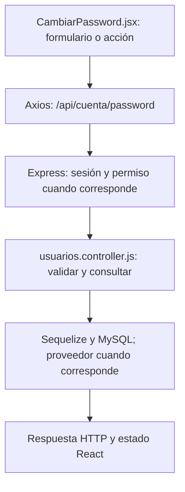

# Simón Castellani · guía de la entrega final

**Responsabilidad:** Perfil, contraseñas y definición de roles.

Conservás perfil, eliminación de cuenta y edición de consumos. Sumás cambio de contraseña, eliminación administrativa de usuarios y creación/modificación de roles.

Este documento asigna estudio, revisión y defensa. No certifica autoría pasada. Antes de exponer, completá las comprobaciones de tu recorrido.

## Primero: base común que puede preguntar el profesor

Leé [BASE-COMUN.md](../docs/BASE-COMUN.md). Son conceptos breves que todos deben entender: carpetas, login, Bcrypt, JWT, middleware, CORS, useState y useEffect. El PDF permite preguntas sobre código de compañeros; no hay garantía de que limite la defensa a este módulo. El detalle profundo que sigue es tu parte.

## Mapa de tu módulo

## Tus endpoints y continuidad

| Etapa | Método y ruta | Handler real |
| --- | --- | --- |
| Base del 50 % | `GET /api/cuenta` | [verCuenta](../backend/controllers/usuarios.controller.js#L248) |
| Base del 50 % | `PUT /api/cuenta` | [actualizarDatos](../backend/controllers/usuarios.controller.js#L253) |
| Base del 50 % | `DELETE /api/cuenta` | [eliminarCuenta](../backend/controllers/usuarios.controller.js#L321) |
| Avance nuevo | `PUT /api/consumos/:id` | [registrarComida](../backend/controllers/nutricion.controller.js#L370) |

## Funciones concretas del avance

| Función | Qué parte recorrés |
| --- | --- |
| [registrarComida](../backend/controllers/nutricion.controller.js#L370) | Tu rama encuentra el consumo propio por id y lo actualiza. |
| [cambiarAlimento](../client/src/pages/Nutricion.jsx) | Edita una copia del alimento y reemplaza la posición. |
| [quitarAlimento](../client/src/pages/Nutricion.jsx) | Quita un alimento de la copia de lista. |
| [editar](../client/src/pages/Nutricion.jsx) | Tu rama carga consumo y fecha/hora para corrección. |
| [copiarComidas](../client/src/pages/Nutricion.jsx) | Revisión con Paulo de copia de listas; no atribuye un endpoint de dietas a tu cargo. |

Los helpers son funciones internas, no endpoints adicionales. Si una función sirve a POST y PUT o a generación y adaptación, se revisa entre los dos responsables. No hay que duplicarla ni separarla artificialmente para aparentar más código.

## Entradas, consultas y respuestas de tus rutas

### `GET /api/cuenta`

**Qué recibe.** Sin body. La identidad sale de la cookie, no de un id elegido en la URL.

**Qué ejecuta y consulta.** La consulta ya la hizo `verificarSesion`: `Sesion.findOne` y `Usuario.findByPk`. `verCuenta` solo devuelve `datosPublicos(req.user)`.

**Qué valida o decide.** Distinguir la consulta del middleware de esta función, que no vuelve a consultar la tabla.

**Respuesta correcta.** `200` → `{user: {id, nombre, apellido, email, telefono, genero, fecha_nacimiento, zona_horaria, consentimiento_ia}}`.

**Errores propios.** El handler no tiene errores propios; los errores de autenticación los devuelve el middleware.

**Quién lo llama.** App.jsx: comprobación inicial `axios.get("/cuenta")`; los datos pasan como props a Cuenta.jsx.

**Cómo mostrarlo.** Recargar con sesión activa y explicar por qué permanece el usuario conectado.

### `PUT /api/cuenta`

**Qué recibe.** Body: `nombre`, `apellido`, `telefono`, `genero`, `zona_horaria`, `consentimiento_ia` booleano; `fecha_nacimiento` opcional. El formulario envía el perfil completo.

**Qué ejecuta y consulta.** Actualiza el `Usuario` cargado por la sesión y crea un evento en `Bitacora`. Cifra el teléfono antes de guardarlo.

**Qué valida o decide.** Nombre y longitudes válidas; género masculino/femenino/otro; fecha de nacimiento real y no futura; zona horaria reconocida. No permite cambiar correo, rol o hash por enviar campos extra.

**Respuesta correcta.** `200` → `{user: ...}` actualizado.

**Errores propios.** `400` por datos/fecha/zona inválidos; `500` si no puede guardar.

**Quién lo llama.** Cuenta.jsx: `guardar` → `axios.put("/cuenta", datos)`.

**Cómo mostrarlo.** Cambiar nombre o consentimiento, guardar y recargar para comprobar persistencia.

### `DELETE /api/cuenta`

**Qué recibe.** Body JSON: `password` actual y `confirmar: true`. Axios lo envía en `{data: {...}}`, no como query.

**Qué ejecuta y consulta.** Compara bcrypt. En una transacción registra un evento sin actor y destruye `req.user`; las claves foráneas borran dependencias o dejan el actor de la bitácora en NULL. Limpia la cookie.

**Qué valida o decide.** Debe ser la cuenta de la sesión y su contraseña correcta. Es un borrado definitivo, no una baja de rutina.

**Respuesta correcta.** `204` sin JSON.

**Errores propios.** `403` si falta confirmar o la contraseña no coincide; `500` si falla la eliminación.

**Quién lo llama.** Cuenta.jsx: `eliminar` y confirmación visible.

**Cómo mostrarlo.** Abrir y cancelar la confirmación. Para probar el borrado, usar solamente una cuenta sintética propia y descartable.

### `PUT /api/consumos/:id`

**Qué recibe.** URL `id` + body completo del POST /api/consumos.

**Qué ejecuta y consulta.** Recalcula macros, busca `ComidaConsumida` propia por id y actualiza su copia de alimentos, fecha y totales.

**Qué valida o decide.** Fecha válida desde el año 2000 y no futura. Se recalculan totales en el servidor; un total enviado aparte por el cliente no reemplaza este cálculo. Cantidades positivas y nutrientes válidos. Editar un consumo es corregir lo registrado, no cambiar una comida del plan.

**Respuesta correcta.** `200` → consumo actualizado.

**Errores propios.** `400` datos inválidos; `404` consumo ajeno/inexistente; `500` por fallo.

**Quién lo llama.** Nutricion.jsx modo consumos: `editar` llena datos y `guardar` usa PUT.

**Cómo mostrarlo.** Cambiar la cantidad de 50 a 100 g y comprobar que el total cambia de 200 a 400 kcal.

## Lo que se agrega en el cierre

`CambiarPassword.jsx/cambiar`: comprueba coincidencia de nueva y repetida, envía actual/nueva a PUT y limpia el usuario de React después del éxito. `cambiarPassword` compara la actual con bcrypt bajo bloqueo de Usuario, cambia el hash y borra Sesion/Recuperacion en la misma transacción. `crearRoles` valida nombre, descripción y lista de permisos reconocidos; crea o modifica el modelo. `modificarRoles` conserva el id. Cliente/Administrador están protegidos. `eliminarUsuario` impide borrarse desde el panel, comprueba que quede un admin activo y elimina la cuenta con cascada; no equivale a bloquear. `actualizarDatos` cifra el teléfono con AES-GCM y solo acepta campos explícitos.

### Rutas nuevas que defendés

| Método y ruta | Función | Archivo |
| --- | --- | --- |
| `PUT /api/cuenta/password` | `cambiarPassword` | [usuarios.controller.js](../backend/controllers/usuarios.controller.js) |
| `DELETE /api/admin/usuarios/:id` | `eliminarUsuario` | [admin.controller.js](../backend/controllers/admin.controller.js) |
| `POST /api/admin/roles` | `crearRoles` | [admin.controller.js](../backend/controllers/admin.controller.js) |
| `PUT /api/admin/roles/:id` | `modificarRoles` | [admin.controller.js](../backend/controllers/admin.controller.js) |

## Preguntas de defensa con respuesta orientativa

**¿Por qué pedir la contraseña actual?** La sesión abierta no demuestra por sí sola que quien está frente a la pantalla puede cambiar el acceso.

**¿Un permiso ocultando un botón es suficiente?** No. verificarPermiso controla cada endpoint; roles personalizados tienen permisos efectivos y el admin tiene acceso completo.

**¿Por qué no devolver password_hash?** No hace falta para la interfaz y es información de autenticación que debe permanecer en el servidor.

## Práctica equivalente para los nueve

- [ ] Recorrer una acción desde el componente hasta MySQL y volver con la respuesta.
- [ ] Mostrar un caso correcto con datos de prueba y persistencia comprobada.
- [ ] Mostrar un caso de datos inválidos y explicar el código HTTP.
- [ ] Mostrar un caso de autorización, cancelación o estado no permitido; no debe cambiar información.
- [ ] Explicar el formulario, las funciones principales, las librerías y el diagrama sin leer código palabra por palabra.
- [ ] Hacer una modificación pequeña y explicar el resultado (por ejemplo un texto, un límite válido o un campo).

## Ensayo individual de 15–20 minutos

2 minutos: ubicar backend/client y tu componente. 5 minutos: seguir una petición propia. 4 minutos: explicar modelo y validaciones. 4 minutos: demostrar éxito/error/cancelación. 3 minutos: responder las preguntas anteriores y los conceptos comunes. No memorizar respuestas sobre funciones que no revisaste.

## Archivos compartidos y continuidad

`backend/index.js` monta las rutas y sirve React; `backend/config/db.js` conecta Sequelize; `backend/models/index.js` relaciona modelos; `client/src/App.jsx` decide navegación y sesión. La base de estos archivos se revisa entre todos. Compartir un archivo no significa que cada persona deba defender todas sus ramas internas: ubicá tu método y seguí sus llamadas.

El reparto final sustituye las estimaciones de carga del corte 75. Cada integrante tiene un paquete completo y la misma lista de comprobaciones; no son porcentajes medidos de autoría ni horas reales.
